# 10 — Výpis akcí: návrh vzhledu

Stav k 4. 11. 2026. Výpis akcí z The Events Calendar vypadal jako výchozí plugin — šedý
seznam bez vztahu ke zbytku webu. Tenhle dokument popisuje, co s tím dělá nové
[`wordpress/vzhled/bm-akce.css`](../../wordpress/vzhled/bm-akce.css), a hlavně **kde je
strop čistého CSS**, protože pravidlo „žádné úpravy šablon pluginu" platí dál.

Zkoušeno na živém stagingu (TEC 6.18.2, Event Tickets 6.13.2, Kadence 1.5.2) tak, že se
CSS vložilo do běžící stránky v prohlížeči. Na webu se nic neměnilo.

| | |
|---|---|
| Nový soubor | `wordpress/vzhled/bm-akce.css` (~1 070 řádků i s komentáři) |
| Nasazení | `nastaveni.py` ho spojí s `bm.css` a pošle do Doplňkového CSS |
| Dotčené pohledy | Seznam, Měsíc, Den, detail akce, lišta filtrů |
| Barvy natvrdo | žádné, všechno přes `var(--global-paletteN)` |
| `!important` | jedno, zdůvodněné u pravidla |

---

## Předtím a potom

V kalendáři byly při focení dvě skutečné akce. Aby šlo posoudit, jak návrh obstojí při
plném programu, je u Seznamu, Měsíce a Dne druhá dvojice obrázků s **třinácti vymyšlenými
akcemi** nasypanými do stránky v prohlížeči (různé kategorie, dlouhé názvy, ceny,
plakáty). Plakáty na nich jsou barevné obdélníky s písmenem, ne skutečné fotky.

### Seznam — skutečná data

| Předtím | Potom |
|---|---|
| 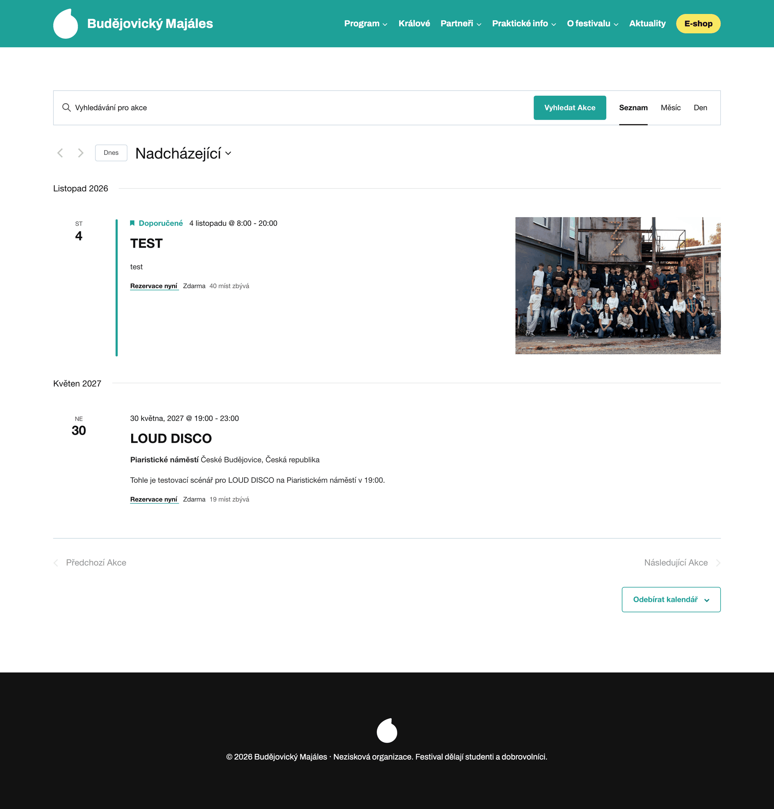 | 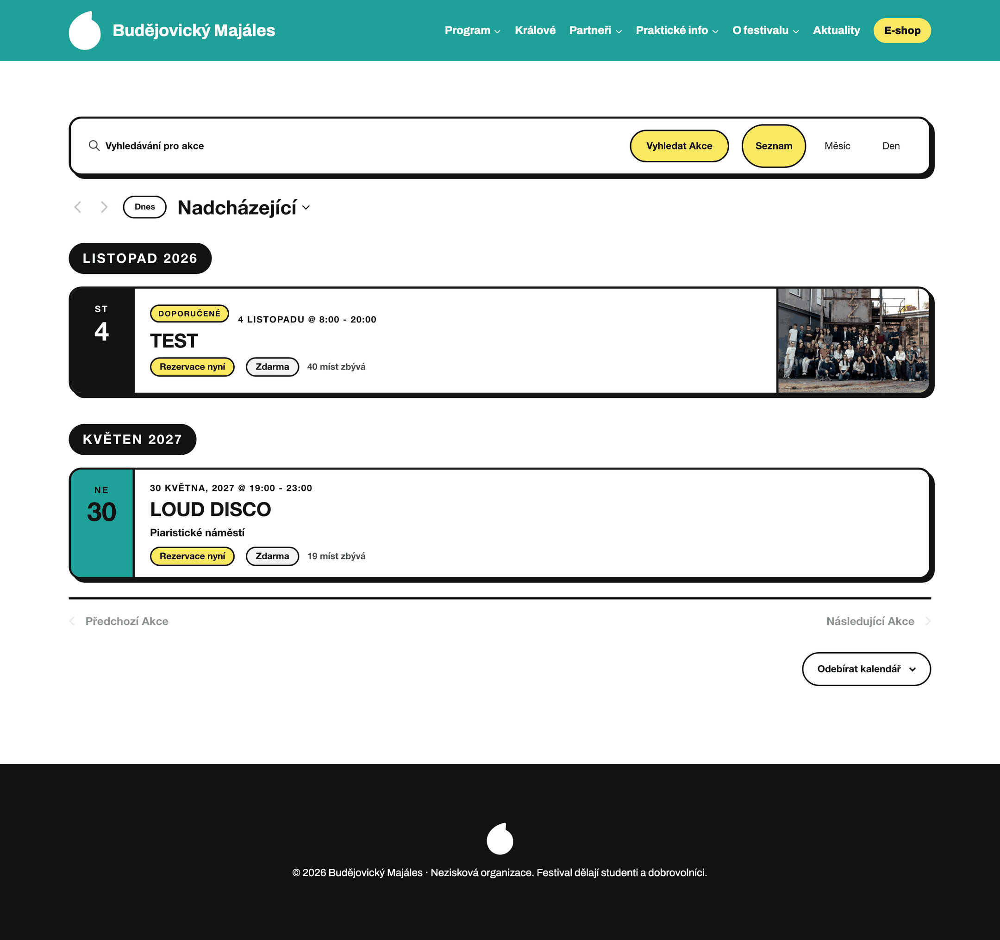 |

### Seznam — plný program, 1440 px

| Předtím | Potom |
|---|---|
| 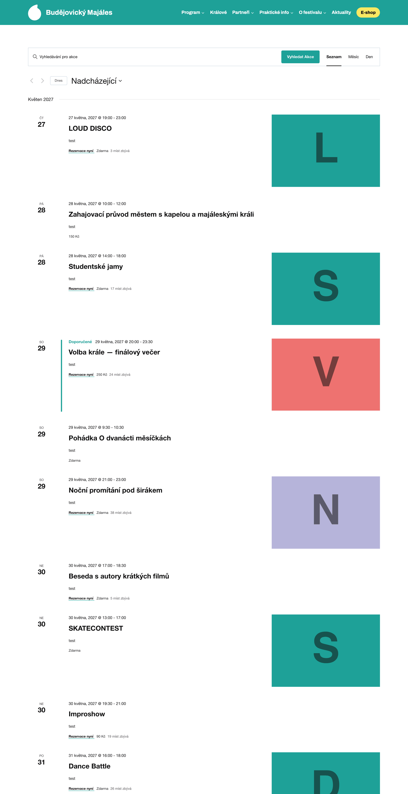 | 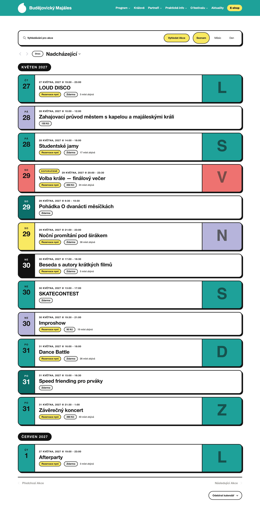 |

### Seznam — plný program, telefon (375 px)

| Předtím | Potom |
|---|---|
| 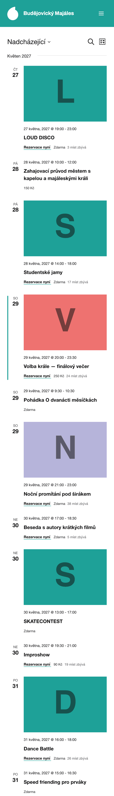 | 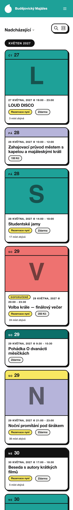 |

Tenčí dvojice na skutečných datech: [před](obrazky/seznam-pred-375.png) ·
[po](obrazky/seznam-po-375.png).

### Měsíc

| Předtím | Potom |
|---|---|
| 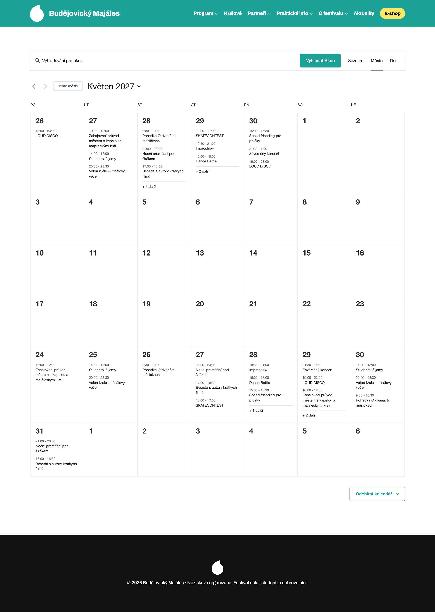 | 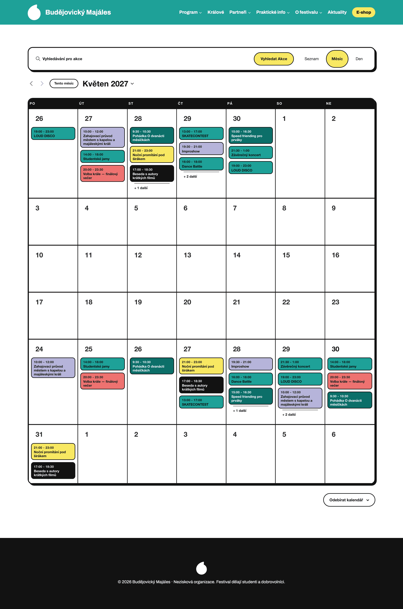 |
| 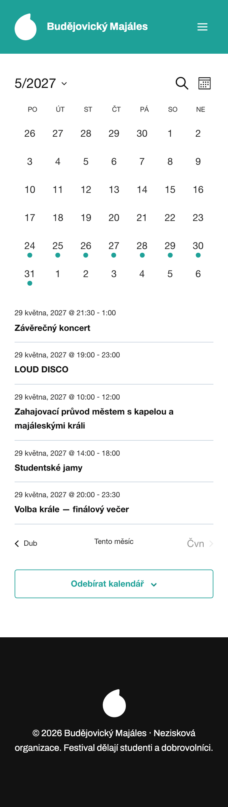 | 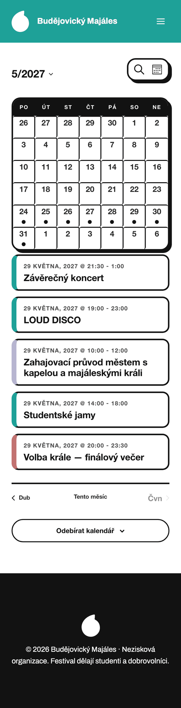 |

### Den

| Předtím | Potom |
|---|---|
| 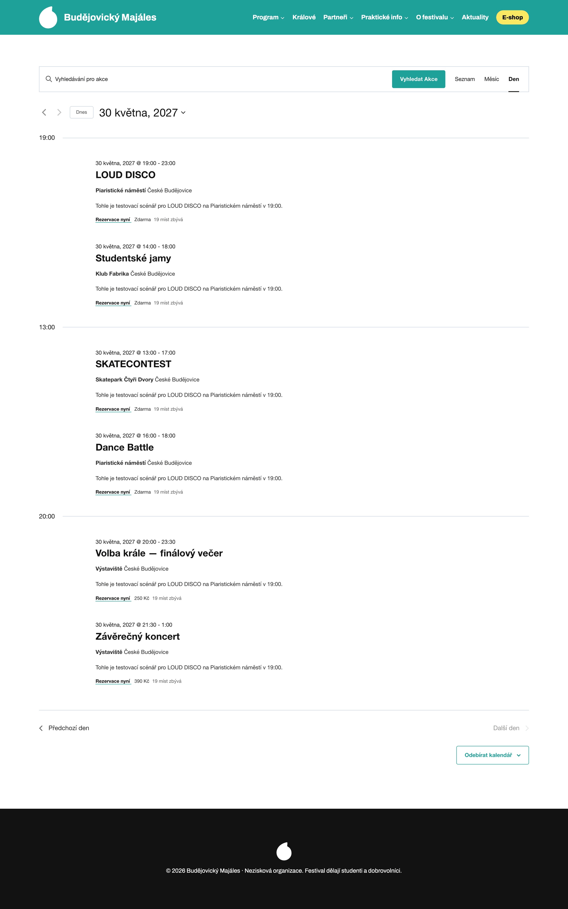 | 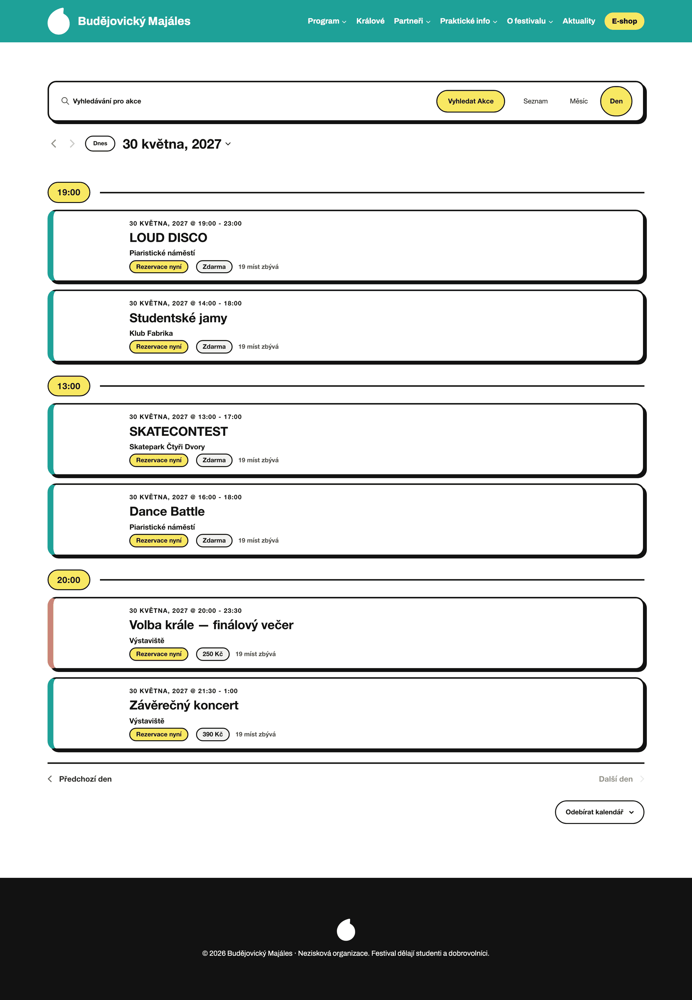 |

### Detail akce

| Předtím | Potom |
|---|---|
| 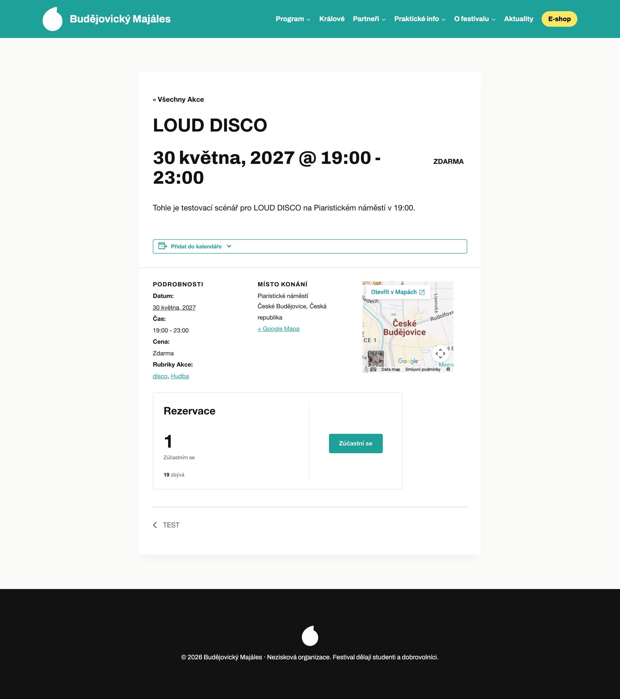 | 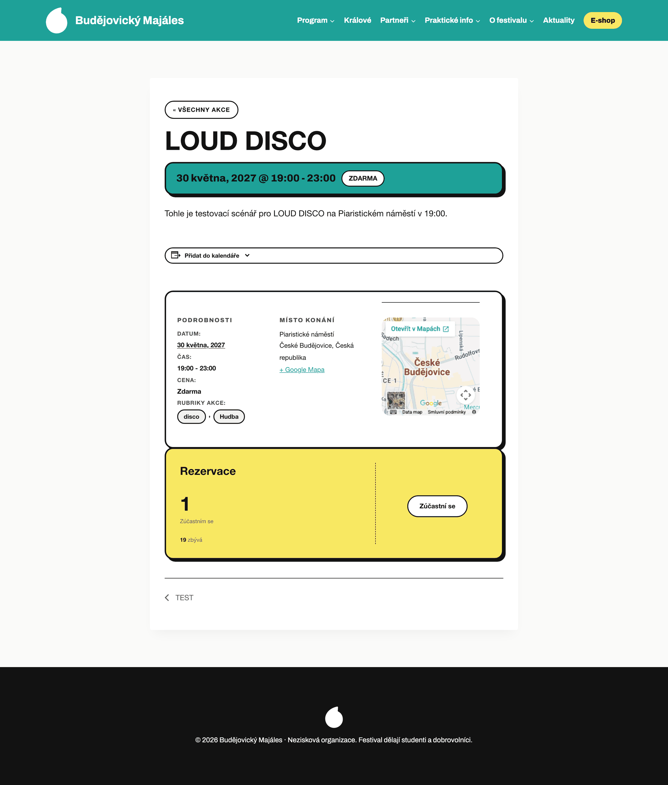 |
| 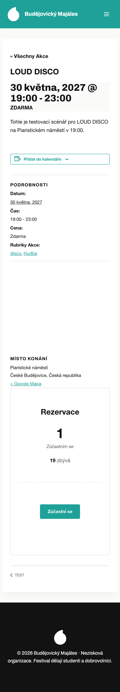 | 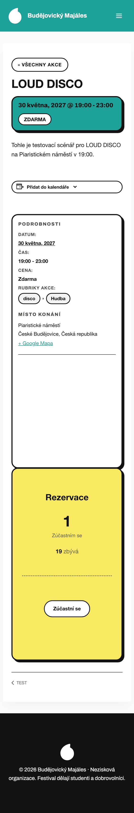 |

---

## Co se změnilo a proč

Vizuální jazyk je stejný jako na úvodní stránce: tvrdý černý rámeček 3 px, plakátový stín
bez rozostření, velká tučná typografie s těsným prokladem, žluté pilulky s černým okrajem.
Nic nového se nevymýšlelo, jen se to přeneslo na pohledy kalendáře.

### Lišta filtrů

Hledání a přepínač pohledů byly tenká šedá linka splývající s pozadím. Teď je to jeden
ohraničený blok se stínem, tlačítko **Vyhledat akce** je žlutá pilulka a Seznam / Měsíc /
Den jsou pilulky, z nichž aktivní je žlutá. Zvolený pohled je tak vidět na první pohled,
což u podtržené záložky nebyl případ.

Šipky, **Dnes** a **Odebírat kalendář** dostaly stejné zaoblení a černý okraj, aby lišta
držela pohromadě.

### Seznam

Hlavní změna celého návrhu: **řádek akce je kartička**.

- **Datumové razítko** v barvě kategorie na levé straně. Velké číslo dne, nad ním zkratka
  dne v týdnu. Při svislém scrollu stovky akcí je to jediná kotva, podle které se člověk
  orientuje.
- **Název** je dvakrát větší než předtím a tučný. Čas se přesunul **nad** název jako
  nadlinka, stejně jako na úvodní stránce; plugin ho vypisuje až za názvem, přerovnává
  se `order`.
- **Plakát** akce (náhledový obrázek) se roztáhne na celou výšku kartičky a odděluje se
  černým rámečkem. Když obrázek chybí, text se roztáhne přes celou šířku — kartička se
  nerozbije.
- **Cena a rezervace** jsou štítky, ne podtržený text v řádku. „Rezervace nyní" je žlutá
  pilulka, protože je to jediná věc, na kterou se tu dá kliknout kromě názvu.
- **Měsíční předěl** je černá pilulka místo šedého popisku s linkou.
- **Adresa města** se skrývá. U všech akcí je „České Budějovice, Česká republika", takže
  na kartičce jen zabírala řádek. Název místa zůstává.
- **Popisek akce** se skrývá. Při stovce akcí dělá z výpisu blog a rozhodnutí „jdu / nejdu"
  stejně padne podle času, místa a barvy. Je to jediné `!important` v souboru — plugin
  popisek zapíná pravidlem `display: block !important`, jinak to nejde. Kdyby ho tým chtěl
  zpátky, stačí to jedno pravidlo smazat.
- **Doporučená akce** (zaškrtávátko u akce v administraci) dostane žlutý štítek
  „DOPORUČENÉ". Text si vypisuje sám plugin a jen se zviditelňuje — v CSS žádný text
  napsaný není, takže se dál překládá přes WordPress.

### Měsíc

- Mřížka má černý rámeček a zaoblení, hlavička s názvy dnů je **černý pás** s bílým
  prostrkaným textem.
- Akce v buňce je **barevný štítek** podle kategorie, s časem a názvem. Barva se tím
  dostane i do pohledu, kde na nic jiného není místo.
- **Dnešek je žlutý**, ne modré kolečko z výchozího vzhledu.
- **Na telefonu** plugin mřížku zúží na samotná čísla s tečkou u dnů, které mají program,
  a po klepnutí vypíše akce pod kalendářem. Ty dostaly stejné kartičky jako Seznam, jen
  s barvou kategorie v levém pruhu.
- Doporučená akce má v mřížce silnější rámeček a vlastní stín — na štítek tam místo není.

### Den

- **Hodina je předěl přes celou šířku** se žlutou pilulkou. V programu festivalu se člověk
  rozhoduje podle času dřív než podle názvu, takže je to nejsilnější prvek stránky.
- Kartička je stejná jako v Seznamu, jen bez datumového razítka (datum je v hlavičce
  pohledu) — barvu kategorie proto nese široký levý pruh.

### Detail akce

Detail jede na **staré šabloně pluginu** (`tribe-events-single`), ne na třídách v2 jako
výpisy. Je to jiná rodina názvů tříd a bylo potřeba s ní pracovat zvlášť.

- Titulek je velký jako hero na úvodní stránce.
- **Datum a cena** jsou v barevném pásu hned pod titulkem.
- **Podrobnosti a místo konání** jsou v jednom ohraničeném bloku se stínem. Plugin nad něj
  a nad každou skupinu v něm kreslil vodorovné linky, které byly širší než blok a trčely
  z rámečku ven — ty jsou pryč.
- **Rubriky akce** jsou štítky. Je to jediné místo v celém pluginu, kde se **vypíše žánr**
  (viz níž).
- **Rezervace** z Event Tickets je žlutá karta — na detailu je to hlavní výzva k akci.
- Na telefonu se tři sloupce podrobností skládají pod sebe; plugin je drží ve flexu,
  kde po mapě zbývala prázdná díra.

### Barvy kategorií

Plugin dává každé akci třídu podle rubriky — `tribe_events_cat-hudba`,
`tribe_events_cat-disco`. Díky must-use doplňku
[`bm-rubriky.php`](../../wordpress/mu-plugins/bm-rubriky.php) má akce se žánrem vždycky
i nadřazenou kategorii, takže se na tyhle třídy dá spolehnout. CSS podle nich nastaví
proměnnou `--bm-kat` a ta řídí razítko, štítek v mřížce i pruh na kartičce dne.

Barvy ročníku jsou čtyři, obsahových kategorií šest. Rozdělení je tedy kompromis:

| Kategorie | Barva | Kontrast textu |
|---|---|---|
| Hudba | zelenomodrá `palette1` | černý text 5,9 : 1 |
| Volba krále | korálová `palette10` — stejně jako pás na úvodní stránce | černý text 6,5 : 1 |
| Divadlo | levandulová `--bm-levandulova` | černý text 9,4 : 1 |
| Filmy | žlutá `palette15` | černý text 14,9 : 1 |
| Program pro nejmenší | tmavší zelenomodrá `palette2` | **bílý** text 6,0 : 1 |
| Studentské promítání, Venkovní scéna, Vnitřní scéna, Online, akce bez kategorie | černá `palette3` | bílý text 18,7 : 1 |

Dvě poznámky k tomu:

**Scény nejsou obsahová kategorie.** Akce nese zároveň „Hudba" i „Venkovní scéna". Kdyby
barvu řídily obě, rozhodovalo by pořadí pravidel v souboru, tedy náhoda. Scény proto
barvu nemají. Stejně tak když akce spadne do dvou barevných kategorií, vyhraje pravidlo
napsané níž — schválně je dole Volba krále, protože ta má zůstat korálová.

**Šest akcí z importu nemá žánr ani kategorii** (viz [05-kostra.md](05-kostra.md)). Ty
dostanou černé razítko. Je to čitelné a zároveň je hned vidět, že u akce něco chybí.

---

## Kde je strop čistého CSS

Tohle je ta část, kvůli které dokument vznikl. Řešení existují ve čtyřech patrech a čím
výš, tím dráž se to bude předávat dál.

### 1. patro — naklikat v administraci, bez kódu

Nejlevnější a nikdy nezastará. Dvě věci stojí za zvážení:

- **Akce → Nastavení → Zobrazení → Category Colors.** The Events Calendar od verze 6.14
  umí barvy rubrik sám. Po zapnutí přibude u každé rubriky výběr barvy a plugin začne na
  kartičku v Seznamu a ve Dni **vypisovat název rubriky** — přesně to, co dnes chybí.
  Podrobnosti jsou v dalším oddílu.
- **Akce → Nastavení** — výchozí pohled je na kartě *Zobrazení*, počet akcí na stránku
  na kartě *Obecné*. Pro festival dává smysl výchozí pohled Den nebo Měsíc, ne Seznam.

### 2. patro — čisté CSS, tedy tenhle soubor

Všechno popsané výš. Stojí na tom, že se plugin dá ovlivnit třemi způsoby:

- **Proměnné `--tec-*`.** Nejodolnější vrstva ze všech, protože je plugin čte sám. Mění
  barvy i v místech, na která žádný selektor nemíří.
- **Třídy `tribe-events-*`.** Stabilní, ale při velké aktualizaci se můžou přejmenovat.
  Pak zmizí ozdoba, ne obsah — výpis bude vypadat jako výchozí plugin, nerozsype se.
- **Třídy rubrik na akci.** Popsané výš.

Co se kvůli pluginu muselo obejít a stojí za zapamatování:

| Co se stalo | Jak se to obešlo |
|---|---|
| Kadence píše barvy kalendáře selektory s `#primary`, což je ID a přebíjí libovolný počet tříd | každé pravidlo začíná `:is(#primary, body)`; `body` zajistí, že pravidlo platí i mimo `#primary`, `#primary` dorovná váhu |
| Popisek akce má `display: block !important` | jediné `!important` v souboru |
| Třída `--other-month` je v mřížce měsíce proti **aktuálnímu**, ne zobrazenému měsíci — při listování dopředu ji nese celá mřížka | nepoužívá se, uplynulé dny se poznají jen podle `--past` |
| Plugin přepíná rozvržení podle šířky **kontejneru** (`tribe-common--breakpoint-*`), ne okna | `@media` se používá jen na to, co si plugin neřídí sám |
| Na detailu je třída rubriky až na vnořeném divu **pod** pásem s datem | `:has()` ji vytáhne nahoru, takže pás má barvu kategorie |

### 3. patro — patnáct řádků v must-use doplňku

Když CSS nestačí, **není nutné sahat na šablony**. The Events Calendar má vlastní
šablonovací vrstvu a ta kolem každého dílu šablony spouští akci
`tribe_template_after_include:<cesta>` a filtr
`tribe_template_after_include_html:<cesta>` — například
`tribe_template_after_include:events/v2/list/event/title`. Ověřeno ve zdrojovém kódu
pluginu (`common/src/Tribe/Template.php`, hooky existují od verze 4.12).

Je to dokumentované rozhraní, ne vnitřnost: přežije aktualizaci stejně jako hooky
WordPressu. Doplněk by se přidal vedle `bm-rubriky.php`, který už v projektu je, a
[jeho README](../../wordpress/mu-plugins/README.md) vysvětluje, proč je výjimka z pravidla
„žádný vlastní kód" přijatelná.

### 4. patro — override šablony

Zkopírovat `tribe/events/v2/list/event.php` do tématu. **Nedoporučuju a nedělal jsem to.**
Šablona se zmrazí v podobě, v jaké byla při zkopírování; při každé aktualizaci pluginu se
musí ručně porovnat a dotáhnout. To je přesně to, co „web musí převzít cizí člověk za
jeden večer" vylučuje.

### Žánr na kartičce — co s tím

**Problém.** V datech je 9 kategorií a 42 žánrů pod nimi. Na kartičce ve výpisu plugin
nevypíše ani jedno — jediné místo, kde se žánr ukáže, je detail akce (sekce *Rubriky akce*,
na obrázku výš jako štítky „disco" a „Hudba").

**Co o tom víme jistě.** Třída na kartičce existuje: akce nese `tribe_events_cat-disco`
i `tribe_events_cat-hudba`. Chybí jen text.

Tři cesty, seřazené podle toho, co bych udělal:

**A) Zapnout Category Colors v administraci — doporučuju vyzkoušet jako první.**
Akce → Nastavení → Zobrazení → Category Colors → *Enable*, pak u každé rubriky nastavit
barvu. Plugin začne vypisovat název **jedné** rubriky na kartičku v Seznamu a ve Dni; která
to bude, rozhoduje priorita nastavená u rubrik. Dá se tím zvolit, jestli se má ukazovat
kategorie (*Hudba*), nebo žánr (*disco*).

Co to stojí: barvy se zadávají natvrdo v administraci, takže by vznikl **druhý seznam
barev** mimo paletu Customizeru a rebranding by znamenal projít devět rubrik navíc. Proti
tomu je v `bm-akce.css` pojistka — tři přiřazení, která pluginem vygenerované barvy přepíší
zpátky na paletu ročníku. Funkce se tedy dá zapnout kvůli textu a barvu si dál řídí paleta.

Co to nedá: v mřížce **Měsíce** se název rubriky neobjeví. Šablona tam ten díl nemá, barvu
dostane jen samotný štítek.

**B) Vypsat název ze CSS přes `content`.** Technicky možné:
`.tribe_events_cat-disco .…__event-title::after { content: " disco" }`. Pro devět kategorií
to je devět řádků, pro 42 žánrů 42 řádků. **Zahodil jsem to**: text by byl napsaný
v CSS, takže by nešel přeložit, nebyl by v HTML pro vyhledávače, nedal by se označit myší
a hlavně by přestal platit v okamžiku, kdy někdo rubriku v administraci přejmenuje nebo
přidá — a nikdo by nevěděl proč. To je přesný opak pravidla o předání za jeden večer.

**C) Doplněk na hooku ze 3. patra.** Kdyby se ukázalo, že varianta A nestačí (třeba protože
jsou potřeba oba štítky najednou, kategorie i žánr), je to cca patnáct řádků v
`mu-plugins`, které na `tribe_template_after_include:events/v2/list/event/title` dopíší
`<span>` se jmény rubrik. CSS na ně už v tomhle souboru připravené je — stačí přidat
selektor vedle štítků rubrik z detailu.

### Na co CSS nedosáhne ani s nejlepší vůlí

| Co | Proč |
|---|---|
| Pole `barva` u rubriky (Secure Custom Fields) | je to hodnota v databázi, CSS ji nepřečte; barvy kategorií jsou proto v CSS napsané přes paletu |
| Bezbariérovost (`bezbarierovost` u místa, `bezbarierovost_vyjimka` u akce) | totéž — v HTML výpisu se neobjeví, musel by ji tam dostat doplněk |
| Filtry podle dne, kategorie, místa a bezbariérovosti | Filter Bar je placené rozšíření; bez něj plugin umí jen fulltext a archivy rubrik (`/events/rubrika/hudba/`) |
| Výpis akcí na stránce Program | zkratka `[tribe_events]` je jen v placené verzi, viz [08-vzhled.md](08-vzhled.md) |
| Pořadí prvků na kartičce napříč sloupci | `order` přeskládá jen prvky uvnitř jednoho flex rodiče; co je v jiném divu, zůstává, kde je |
| Víc akcí v jednom dni v mřížce Měsíce než tři | počet řídí plugin, CSS změní jen vzhled odkazu „+ 2 další" |

---

## Přístupnost a kontrast

- Všechny kombinace barvy a textu prošly WCAG AA (minimum 4,5 : 1). Nejtěsnější je
  zelenomodrá s černým textem, 5,9 : 1. **Bílý text na zelenomodré má jen 3,2 : 1**
  a v návrhu se nikde nepoužívá — na barevných plochách je text černý všude kromě tmavé
  zelenomodré a černé.
- Posun kartičky při najetí myší respektuje `prefers-reduced-motion: reduce`.
- Nic se neskrývá jen barvou: kategorie je kromě barvy razítka vidět i v detailu jako
  štítek.
- Štítek „DOPORUČENÉ" vzniká zviditelněním textu, který plugin vypisuje pro odečítače
  obrazovky — odečítač tedy čte totéž co dřív.
- Šedý text (`palette5`) má na bílé 8,9 : 1, používá se jen na druhotné údaje.

---

## Co jsem zvažoval a zahodil

**Kartičky do mřížky dva až tři sloupce vedle sebe.** Vypadá to dobře na screenshotu, ale
program festivalu se čte chronologicky. V mřížce přestanou dávat smysl měsíční předěly
a datumové razítko, a na telefonu se stejně složí do jednoho sloupce. Svislý seznam
s velkým datem je pro „co se děje v sobotu večer" rychlejší.

**Zkrácení popisku akce na dva řádky místo skrytí.** Řez uprostřed věty vypadá nedodělaně
a při stovce akcí by výpis prodloužil o třetinu. Skrytí je jedno pravidlo, které tým umí
smazat, pokud se rozhodne jinak.

**Šedé pozadí u dnů z jiného měsíce.** Vypadalo to dobře, dokud jsem nelistoval na jiný
měsíc — plugin značkuje `--other-month` proti aktuálnímu měsíci, takže v květnu 2027 má
tu třídu celá mřížka a zešedla by celá. Zahozeno, zůstalo jen ztmavení uplynulých dnů.

**Přilepená (sticky) hodina v pohledu Den.** Hezké při dlouhém dni, ale pere se to
s přilepenou hlavičkou webu a na telefonu ubírá výšku. Nestojí to za riziko.

**Ikona bezbariérovosti na kartičce.** Je to pole v databázi, do HTML se nedostane. Patřilo
by to do doplňku ze 3. patra; dávalo by smysl to udělat najednou se žánrem, ne zvlášť.

**Vlastní paleta barev pro všech devět kategorií.** Čtyři barvy ročníku na devět kategorií
nestačí a vymýšlet páté a šesté by znamenalo barvy, které nejsou v grafice a nikdo je při
rebrandingu nepřepíše. Zbytek je proto černý.

---

## Jak to nasadit a ověřit

CSS je zdrojem pravdy v repozitáři, do webu ho dostane skript:

```bash
export BM_WP=~/bm-wordpress/staging/wp.txt
cd wordpress/vzhled
python3 nastaveni.py
```

`nastaveni.py` nově skládá Doplňkové CSS ze **dvou** souborů v tomhle pořadí (konstanta
`CSS_SOUBORY`):

1. `bm.css` — zbytek webu, definuje `--bm-levandulova`, `--bm-ramecek`, `--bm-radius`
2. `bm-akce.css` — kalendář, na ty proměnné navazuje

Samotný `bm-akce.css` vložený bez `bm.css` nefunguje. Blok s proměnnými pluginu, který byl
dřív v `bm.css`, je teď v `bm-akce.css` — ať je všechno ke kalendáři na jednom místě.

Pokud někdo upraví CSS přímo v administraci, musí změnu vrátit do příslušného souboru,
jinak ji příští běh `nastaveni.py` přepíše. To platilo i dřív.

**Na co se po nasazení podívat:**

1. `/events/` na počítači i na telefonu — kartičky mají rámeček, stín a barevné razítko.
2. `/events/mesic/` — hlavička mřížky je černý pás, dnešek žlutý.
3. `/events/dnes/` — hodina je žlutá pilulka přes celou šířku.
4. Detail akce — pás s datem má barvu kategorie, rubriky jsou štítky.
5. Akce bez kategorie má černé razítko. Když je takových moc, chybí rubriky v datech,
   ne styl.
