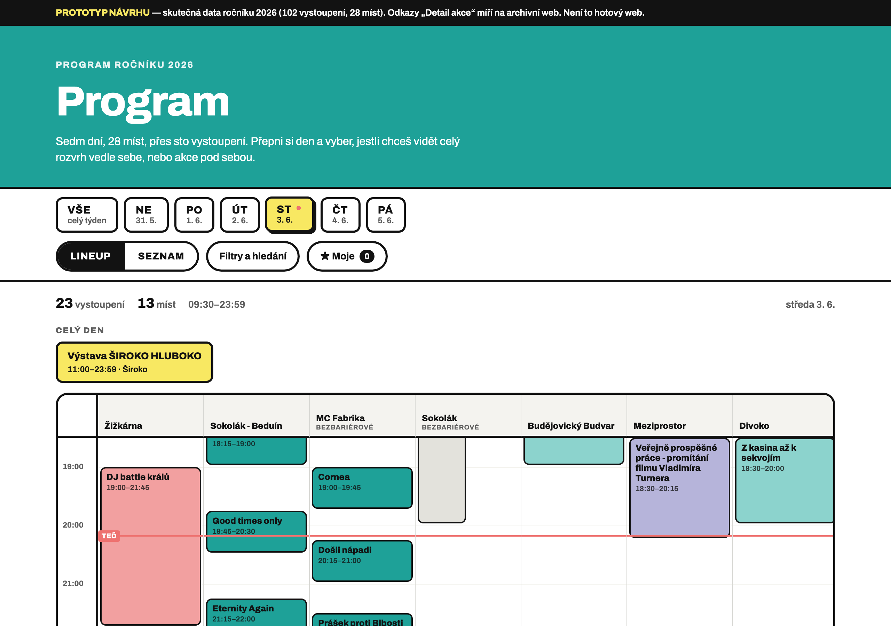
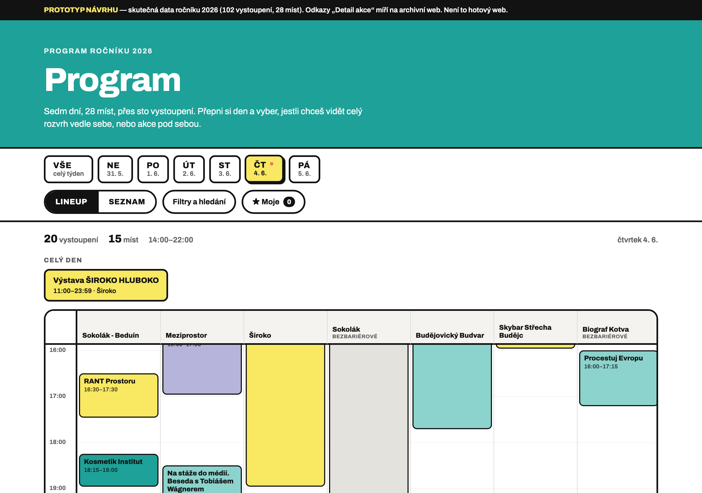
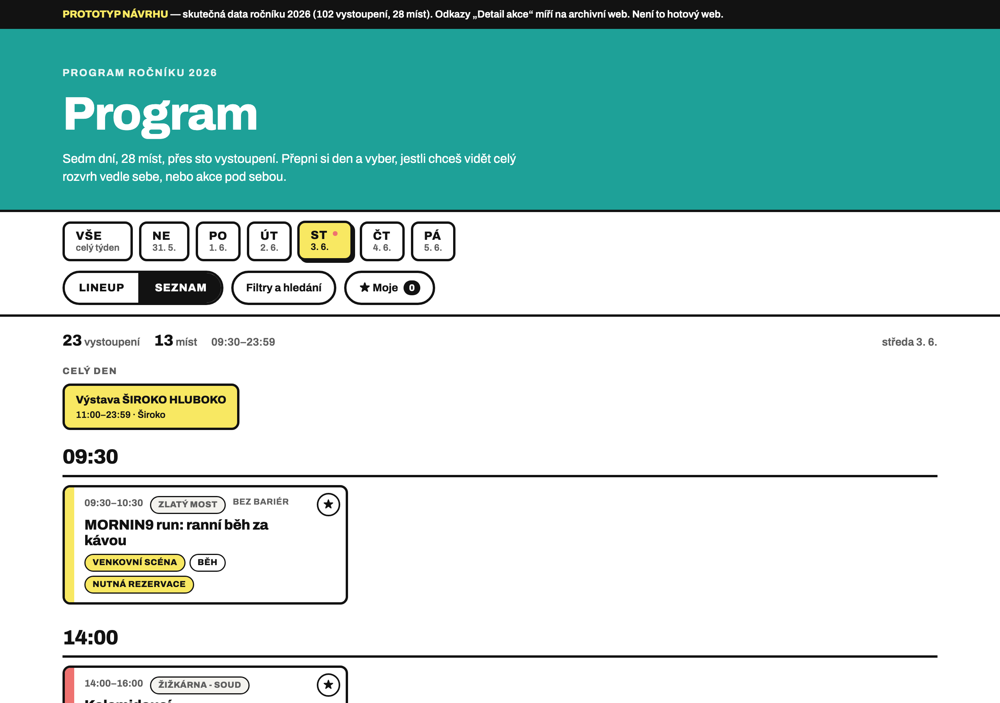
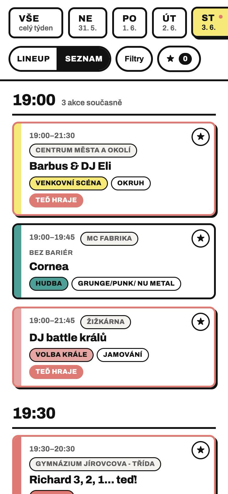
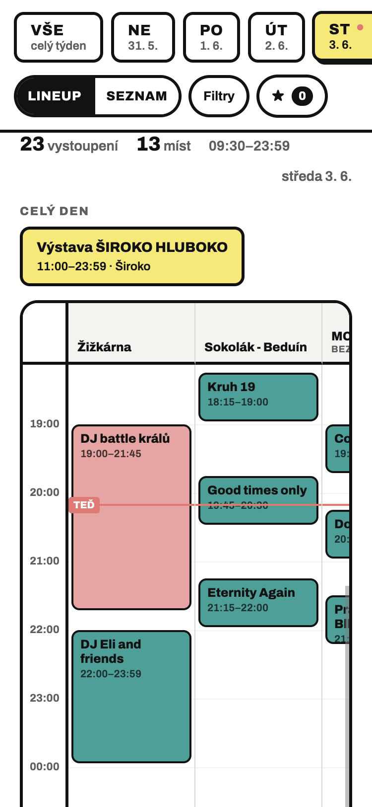
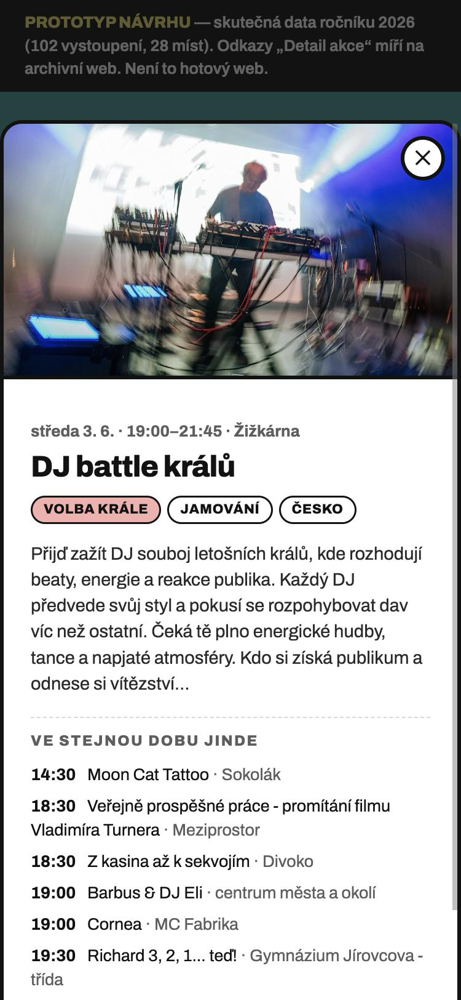
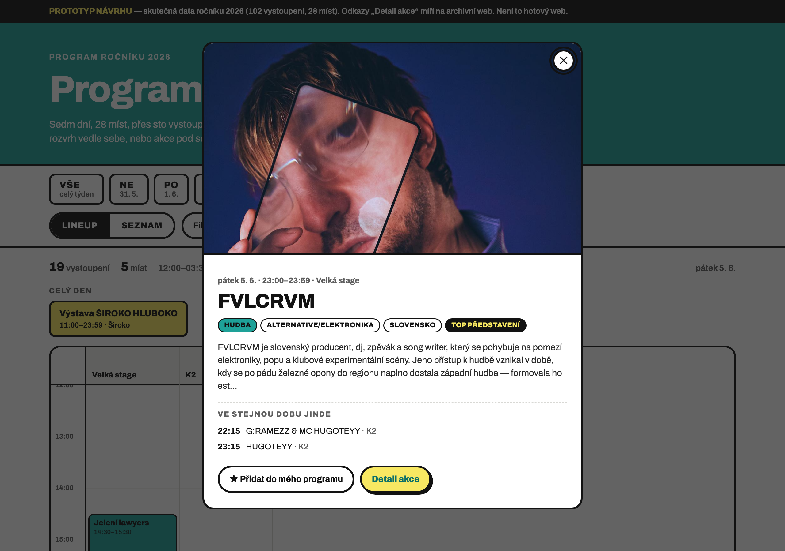
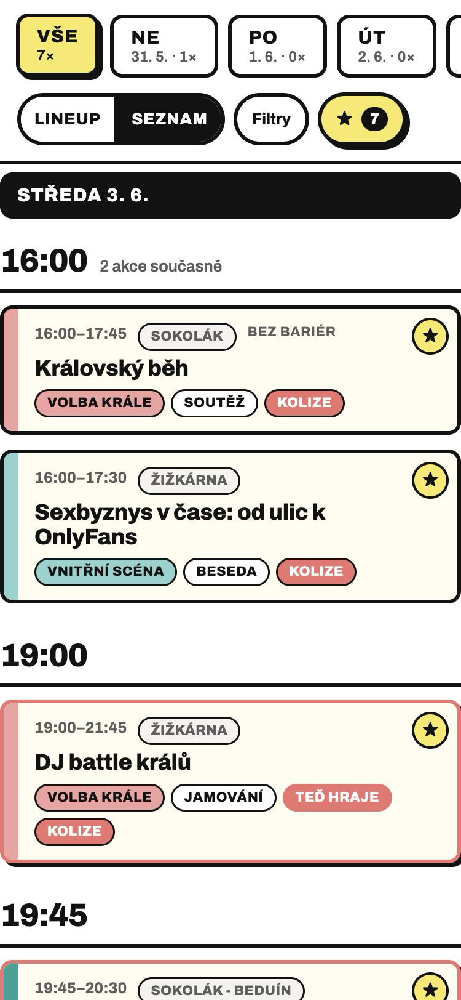
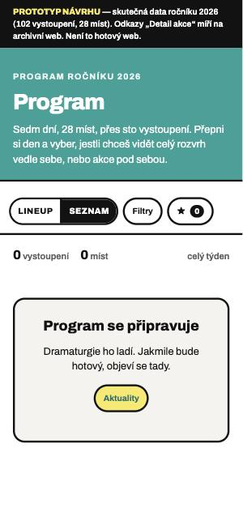

# 11 — Program a lineup: návrh

Stav k 4. 11. 2026. **Návrh, ne implementace.** Dokud ho zadavatel neschválí, nic se nestaví.

Klikatelný prototyp: [`prototyp.html`](prototyp.html) — jeden soubor, otevře se dvojklikem,
žádný server. Obsahuje **skutečný program ročníku 2026**: 102 vystoupení, 28 míst,
6 kategorií, 47 žánrů.

---

## Co se navrhuje

Jedna stránka `/program/`, která vždycky ukazuje **jeden den** a nabízí k němu
**dvě zobrazení téhož**:

| | |
|---|---|
| **Lineup** | Časová osa. Svisle čas, vodorovně scény vedle sebe. Vidíš, že ve 20:00 hraje DJ battle na Žižkárně a zároveň Good times only na Beduínu. |
| **Seznam** | Akce pod sebou, seskupené po časech. U nadpisu „19:00" stojí „3 akce současně" a pod ním tři karty. |

Nad nimi společné ovládání: **dny festivalu**, **filtry** (kategorie, místo, hledání)
a **★ Moje** — osobní výběr s upozorněním na kolize.

Výchozí stav je **aktuální den**; co se ukáže jedenáct měsíců v roce, kdy žádný
aktuální den neexistuje, řeší [samostatná kapitola](#výchozí-den-a-jedenáct-měsíců-bez-festivalu).



---

## Proč zrovna takhle

### Osa je správná odpověď, jen ne na mobilu

Časová osa s paralelními scénami je jediné zobrazení, které odpovídá na otázku
„na co nestihnu jít, když půjdu sem". Proto zůstává a je výchozí na desktopu.

Ale data říkají, proč nemůže být jediná:

| Den | Míst | Akcí | Šířka osy |
|---|---:|---:|---|
| neděle 31. 5. | 3 | 6 | 514 px |
| pondělí 1. 6. | 6 | 14 | 970 px |
| úterý 2. 6. | 9 | 20 | 1 426 px |
| středa 3. 6. | 13 | 23 | 2 034 px |
| **čtvrtek 4. 6.** | **15** | **20** | **2 338 px** |
| pátek 5. 6. | 5 | 19 | 818 px |

Obsah webu má 1 160 px. **Čtvrteční osa se nevejde ani na desktop**, natož na
telefon se 375 px. Pohoda si s osou vystačí, protože má čtyři scény. My máme
patnáct. Osa proto jede ve vlastní posuvné ploše s přilepeným sloupcem času
a přilepenou hlavičkou scén — ve stejném duchu, v jakém to dělá Clashfinder.



### Seznam není náhradní řešení

Zadání připouští, že tahle stránka **nahradí pohledy The Events Calendar úplně**.
Seznam je proto plnohodnotný, ne ústupek pro mobil:

- Řadí se podle času a lepivý nadpis s hodinou drží nahoře, takže je pořád vidět,
  u které hodiny člověk je.
- U nadpisu stojí **„3 akce současně"** — paralelnost scén je vidět i bez osy.
- Má přepínač **VŠE**, který ukáže celý týden v jednom seznamu (vzor: záložka
  „All" u Clashfinderu). Tím pokrývá, co dnes umí pohled Seznam v kalendáři.
- Každá karta nese čas, místo, kategorii, žánr a štítek rezervace. Klik na místo
  filtruje na tuhle scénu, takže „ukaž mi běh večera na Žižkárně" je jedno ťuknutí.

Kdo řekne „osa mě nezajímá, chci jen seznam", nepřijde o nic.



### Barva nese kategorii, ne žánr

Kategorií je v taxonomii devět (v programu 2026 se jich objevilo šest), žánrů 47.
Devět barev na tvrdém černém rámečku člověk ještě rozliší, 47 ne. Barva proto nese **kategorii** (Hudba, Divadlo, Filmy, Venkovní
scéna, Vnitřní scéna, Volba krále) a žánr je text na štítku.

Zdroj barvy je kaskáda: pole **Barva** u kategorie (už existuje, SCF color picker
na `tribe_events_cat`) → proměnná `--bm-kat-<slug>` v CSS → šedá. Šest akcí
v datech 2026 nemá kategorii ani žánr; vykreslí se šedé, nevypadnou z programu.

### Co se v datech skrývalo

Tři věci, které návrh musel vyřešit a bez skutečných dat by se neobjevily:

**Festivalový den nekončí o půlnoci.** V datech 2026 jsou tři sety na K2 —
BROCK 00:15, HANZALL 01:15, BASSDEALER 02:30. Patří k pátečnímu večeru, ale
kalendářně je to sobota. Stará osa v AngularJS je **neukázala vůbec**: program má
102 vystoupení, lineup jich zobrazoval 99. Návrh zavádí hranici dne v **6:00** —
co začíná dřív, patří k předchozímu dni. Pátek tím jede 12:00–03:30 a sedmá
záložka pro tři ranní sety nevzniká.

**Celodenní akce by osu rozbily.** Výstava ŠIROKO HLUBOKO běží 11:00–23:59, pět
dní po sobě. Jako blok by zabrala celý sloupec. Má proto vlastní pás **Celý den**
nad osou a v seznamu stojí nahoře, ne mezi sety.

**Na jednom místě se občas překrývají dvě akce.** Čtyřikrát v datech 2026 —
třeba BudeCirkus a Leisureshop na Sokoláku ve stejnou hodinu. Osa v takovém
případě rozdělí šířku sloupce, nic neschová.

---

## Jak je vyřešený mobil

**Výchozí zobrazení na mobilu je Seznam, ne osa.** Lineup je ale dostupný —
jedním ťuknutím, ne schovaný.



Ovládací pruh je na mobilu **dvouřádkový a drží nahoře** (134 px z 812): záložky
dnů, které se posouvají prstem, a pod nimi přepínač zobrazení, Filtry a ★. Hledání
bydlí uvnitř panelu filtrů — třetí řádek lepivého ovládání by sežral čtvrtinu
displeje.

Osa na mobilu ukáže dvě scény a kus třetí, posouvá se do stran, sloupec s časy
a hlavička scén jsou přilepené:



Detail akce vyjede **odspodu** jako bottom sheet — palec na něj dosáhne. Nese
fotku, popis, rezervaci a seznam **„Ve stejnou dobu jinde"**, což je ta samá
informace, pro kterou lidi chodí na osu, jen podaná jednou akcí. Na desktopu
je to totéž uprostřed obrazovky.




### Co jsem zvažoval a zahodil

| Varianta | Proč ne |
|---|---|
| **Osa jako výchozí i na mobilu** | 15 scén = 2 338 px. Dvojí posouvání (prstem do stran i dolů) na telefonu v hluku a šeru nefunguje. Clashfinder má mobilní mřížku taky, ale až jako čtvrtou záložku. |
| **Scény jako řádky, čas vodorovně** (dělá Pohoda) | Pěkné pro čtyři scény. U patnácti je to patnáct řádků, ve kterých se musí hledat, a „co hraje teď" vyžaduje doscrollovat na správné místo osy. |
| **Seznam seskupený po scénách** (výchozí u Clashfinderu) | Odpovídá na „co se děje na Žižkárně", ale ne na „co hraje ve 20:00" — a to je ta častější otázka. Řešíme to filtrem místa, ne druhým režimem. |
| **Jen PDF ke stažení** (dělá Roskilde) | Na telefonu se PDF nečte a nejde aktualizovat, když se program změní. |
| **Zvlášť stránka Lineup a zvlášť Program** | Tak to bylo na starém webu a lidi mezi nimi bloudili. Jedna stránka, dvě zobrazení. |

### Můj program a kolize

★ u každé akce, uloženo do `localStorage` prohlížeče — **žádný účet, žádná
registrace, nic se neposílá na server.**

Dvě věci navíc, které to posouvají z „seznam oblíbených" na něco užitečného:

1. **Kolize.** Když se dvě vybrané akce časově překrývají, obě dostanou červený
   štítek KOLIZE a nahoře je shrnutí. Tohle je důvod, proč si člověk program
   skládá předem.
2. **Zapnutí ★ přepne na celý týden.** Vybrané akce jsou skoro vždycky rozházené
   po dnech; kdyby „Jen moje" nechalo zapnutý jeden den, většina lidí by poprvé
   uviděla prázdno. Záložky dnů při tom ukazují, kolik akcí má člověk vybraných
   kde (`31. 5. · 1×`).



Výběr se dá **poslat odkazem** (`/program/?moje=684,707,713`). Kdo na něj klikne,
uvidí rovnou cizí výběr a akce se mu **přidají** k jeho vlastním — ne přepíšou.
Přijít o svůj program kliknutím na cizí odkaz by bylo horší než ho mít navíc.
Stránka to napíše: „Ze sdíleného odkazu přibylo 7 vystoupení."

Jedna akce jde poslat taky: `/program/?akce=757` otevře rovnou její detail.

---

## Výchozí den a jedenáct měsíců bez festivalu

Zadavatel řekl „výchozí stav je aktuální den". To platí šest dní v roce.
Zbylých 359 potřebuje pravidlo.

**Pravidlo je jedno:**

> Když dnešek padne do některého dne ročníku, ukáže se **dnešek**.
> Jinak **první den ročníku**.

Hranice dne je stejná jako u programu — **6:00 ráno**. Ve dvě v noci tedy pořád
platí včerejšek, takže kdo během afterparty otevře program, uvidí, co ještě hraje,
ne prázdný zítřek.

Ke dvěma situacím se přidá jednořádkové vysvětlení, aby nikdo nemusel hádat:

| Kdy | Co se ukáže | Hláška |
|---|---|---|
| Před festivalem | První den | „Festival ještě nezačal. Ukazujeme první den ročníku — neděle 31. 5." |
| Během festivalu | Dnešek, osa doscrollovaná na „teď", u akcí štítek TEĎ HRAJE | — |
| Po festivalu | První den | „Ročník už skončil. Tohle je jeho program, ne nadcházející." |
| Žádné akce v ročníku | Prázdný stav s odkazem na Aktuality | „Program se připravuje." |

**Proč ne „nejbližší nadcházející den".** Před festivalem je to totéž co první den.
Po festivalu žádný nadcházející den neexistuje, takže by se stejně muselo dopsat
druhé pravidlo. Jedno pravidlo místo tří.

**Proč ne prázdná stránka s odpočtem.** Program je celoročně nejnavštěvovanější
stránka webu a loňský program má hodnotu — lidi hledají „kdo tam vlastně hrál".
Prázdná stránka po deseti měsících navíc vypadá jako mrtvý web.

**Proč ta hláška.** Bez ní někdo nahlásí, že web ukazuje starý program jako
nadcházející. S ní je to archiv, a archiv je v pořádku.



---

## Data: co to potřebuje a co The Events Calendar umí

Ověřeno proti skutečnému API na <https://novy.budejovickymajales.cz> dne 4. 11. 2026,
ne proti dokumentaci.

| Co návrh potřebuje | Odkud | Umí to free TEC? |
|---|---|---|
| Název, popis, výřez | `tribe/events/v1/events` → `title`, `description`, `excerpt` | ano |
| Začátek a konec včetně času | `start_date_details`, `end_date_details` (rozpad na rok/měsíc/den/hodinu) | ano |
| Celodenní akce | `all_day` | ano |
| Místo | `venue.venue`, `venue.slug`, `venue.url` | ano |
| Kategorie a žánr | `categories[]` — rodič má `parent: 0`, žánr má `parent: <id kategorie>` | ano, jedním dotazem |
| Rezervace | `ticketed: ["rsvp"]` | ano |
| Top představení | `featured` | ano — v návrhu to je černý štítek „Top" a silnější rámeček na ose |
| Skrýt z výpisů | `hide_from_listings` | ano |
| Obrázek | `image.url` | ano |
| Země původu | `tags[]` | ano (jako štítek) |
| Odkaz na detail akce | `url` | ano |
| **Barva kategorie** | **ne v TEC** → `wp/v2/tribe_events_cat` → `acf.barva` | pole už existuje |
| **Bezbariérovost místa** | **ne v TEC** → `wp/v2/tribe_venue` → `acf.bezbarierovost` | pole už existuje |
| **Termín ročníku** | `wp/v2/rocnik` → `acf.datum_od`, `acf.datum_do` | pole už existuje |
| **Pořadí scén** | **nikde** — TEC u místa pořadí nedrží | řeší se výpočtem, viz níže |

### Tři věci, na které se musí dát pozor

**`per_page` je zastropované na 50.** Požádal jsem o 100 a odpověď se vrátila
s `per_page=50` v `rest_url`. 102 akcí = **tři požadavky**, ne jeden. Stránkuje se
přes `?page=`.

**Výchozí časový rozsah je „dnes až +2 roky".** Program ročníku se proto musí
vyžádat výslovně. Hodnoty se berou z termínu ročníku, ne z konstanty v kódu —
tím se web po ročníku přepne sám. Pozor ale na konec rozsahu:

```
start_date = datum_od                       → 2027-05-30 00:00:00
end_date   = datum_do + 1 den, 06:00:00     → 2027-06-06 06:00:00
```

Kdyby se poslalo jen `end_date=datum_do`, TEC si to přeloží jako `23:59:59`
posledního dne a **vypadnou přesně ty tři ranní sety na K2**, které ztratila
i stará osa. Šestá hodina je ta samá hranice dne, kterou používá zbytek návrhu —
jedna konstanta, dvě použití.

Ověřeno, že filtr zahrnuje i **probíhající** akce: dotaz od 20:00 vrátil akci,
která začala v 19:00 a končí ve 23:00. Výstavy a celodenní akce tedy nevypadnou.

**Názvy míst chodí s HTML entitami** — `Žižkárna &#8211; garáž`. Musí se dekódovat,
jinak je to v programu vidět.

### Který ročník stránka ukazuje

Taxonomie `rocnik` bude mít po pár letech víc termínů. Pravidlo:

> **Nejnovější termín, který má aspoň jednu akci.** Když takový není, nejnovější
> termín vůbec — a stránka ukáže stav „Program se připravuje".

Na tom záleží víc, než to vypadá: jakmile někdo v prosinci založí termín 2028,
aby mohl zadávat program, nesmí tím zmizet archiv 2027. S tímhle pravidlem
zůstane 2027 na stránce až do chvíle, kdy do 2028 přibude první akce.

### Pořadí scén

TEC u místa žádné pořadí nedrží a free verze na to nemá pole. Pravidlo je proto
výpočet: **čím víc akcí daný den, tím dřív** — při shodě rozhoduje dřívější
začátek, pak abeceda. Je to deterministické a nikdo to nemusí udržovat. Kdyby
organizátoři chtěli hlavní scénu vždycky vlevo, přibude u místa číselné pole
a předřadí se téhle úvaze (odhad 1,5 h).

### Jak se prototyp liší od ostrého webu

V prototypu jsou data zmrazená uvnitř HTML, **ve stejném tvaru, jaký vrací API**.
Na ostrém webu se vymění jediná funkce `nactiData()` — tři `fetch`e místo jednoho
`JSON.parse`. Zbytek skriptu se nemění, protože už teď čte `start_date_details`,
`venue.slug`, `categories[].parent` a tak dál.

---

## Izolace: jak to nerozbije zbytek webu

Projekt má železné pravidlo: **web musí převzít cizí člověk za jeden večer.**
Lineup je jediné místo, kde se vlastní kód připouští. Izolace stojí na šesti
pravidlech a jednom testu.

### Kde to bydlí

```
wordpress/mu-plugins/
├── bm-rubriky.php          (už existuje — dědičnost rubrik)
└── bm-program/
    ├── bm-program.php      ~60 řádků PHP
    ├── program.js          ~750 řádků (tolik jich má prototyp)
    └── program.css         ~470 řádků
```

PHP dělá **jen tři věci**: zaregistruje zkratku `[bm_program]`, zařadí CSS a JS,
a vypíše prázdný `<div>` se záchranným blokem uvnitř. Žádná logika, žádný dotaz
do databáze, žádná šablona.

### Pravidla

1. **Nesahá na šablony pluginu.** Žádná složka `tribe/` v tématu, žádný
   `tribe_get_template_part`. Tohle je to, co se rozbije při první aktualizaci.
2. **Nevolá žádnou PHP funkci The Events Calendar ani Event Tickets.** Jediný styk
   s pluginem jsou veřejné REST endpointy. Když TEC změní vnitřnosti, nás se to
   netýká.
3. **Nevěší se na nic globálního.** Žádný `pre_get_posts`, žádný filtr obsahu.
   Jedna zkratka, která funguje jen tam, kam ji někdo vloží.
4. **Nezapisuje do databáze.** Výběr „Moje" žije v `localStorage` prohlížeče.
   Žádná tabulka, žádná migrace, žádné osobní údaje.
5. **Barvy jen přes paletu.** Každá barva je `var(--global-paletteN, #záložní-hex)`.
   Když paleta existuje, vyhraje; prototyp a případný výpadek jedou na záložní hex.
6. **Všechen JS je ve `window`-neznečišťujícím IIFE.** Nedefinuje nic globálního,
   takže nemůže kolidovat s Kadence ani s pluginy.

### Test, jestli izolace drží

> Smaž složku `wp-content/mu-plugins/bm-program/` a načti `/program/`.
> Na stránce zůstane text `[bm_program]` a **funkční odkazy do kalendáře akcí**.
> Program je pořád dostupný. Smažeš ten jeden blok ze stránky a je čisto.

Stejný záchranný blok se ukáže i tehdy, když je vypnutý JavaScript, spadne skript
nebo je nedostupné REST API. Není ve `<noscript>` — je v HTML pořád a skript ho
odstraní, až když se program **opravdu** vykreslí. Celý start je v `try`/`catch`.

### Jedno pravidlo pro provoz

**Nativní pohledy The Events Calendar se nikdy nevypínají.** I když se na ně
z menu nebude odkazovat, `/events/list/`, `/events/month/` a `/events/today/`
musí zůstat funkční — jsou to ty odkazy v záchranném bloku. Vyndat z menu ano,
vypnout ne.

---

## Pracnost

Rozděleno do tří fází, které jdou objednat zvlášť. Každá je použitelná sama o sobě.

### Fáze 1 — Seznam (bez ní to nejede)

| Práce | Hodin |
|---|---:|
| Kostra mu-pluginu: zkratka, zařazení CSS/JS, záchranný blok | 2 |
| Načtení dat z REST: tři endpointy, stránkování po 50, spojení | 4 |
| Normalizace: festivalový den, půlnoc, celodenní akce, chybějící místo a kategorie | 3 |
| Zobrazení Seznam: lepivé časy, karty, detail akce | 6 |
| Přepínač dnů, výchozí den, čtyři stavy ročníku, stav v adrese | 3 |
| Filtry: kategorie, místo, hledání | 3 |
| CSS napojené na paletu Kadence | 4 |
| Přístupnost: klávesnice, čtečky, kontrast, velikost dotykových ploch | 2 |
| Test na skutečném telefonu (iOS Safari i Android Chrome) | 4 |
| Dokumentace pro tým a pro nástupce | 1,5 |
| **Celkem** | **32,5** |

### Fáze 2 — Lineup (časová osa)

| Práce | Hodin |
|---|---:|
| Mřížka: přilepený sloupec času a hlavička scén, pozicování bloků, překryvy | 8 |
| Čára „teď" a doscrollování na ni | 1,5 |
| Ladění osy na mobilu (vnořené posouvání, iOS Safari) | 3 |
| **Celkem** | **12,5** |

### Fáze 3 — Můj program

| Práce | Hodin |
|---|---:|
| Hvězdičky, `localStorage`, režim „jen moje", počty u dnů | 3 |
| Detekce kolizí | 1,5 |
| Sdílecí odkaz a odkaz na jednu akci | 1,5 |
| **Celkem** | **6** |

### Dohromady 51 hodin — a to je víc, než říkala analýza

[00-analyza.md](../00-analyza.md) počítá s **14 h** na „mřížku programu
v kartičkovém vzhledu" a vlastní osu v doporučeném rozsahu vůbec nemá
(dropla se jako „~10 h"). Rozdíl není v tom, že by odhad nafoukl — je v tom, že
se mezitím změnilo zadání:

- těch 14 h byly kartičky ve mřížce, ne stránka s přepínáním dnů, filtry,
  detailem a čtyřmi stavy ročníku,
- přibyl požadavek, že tahle stránka může **nahradit kalendář úplně**, takže
  musí umět i to, co dnes umí nativní pohledy,
- přibyl „můj program", který v původním rozsahu nebyl vůbec.

**Když se musí vejít do dvaceti hodin**, dá se uříznout tohle:

| Co vypustit | Ušetří |
|---|---:|
| Hledání (filtry zůstanou) | 2 |
| Filtr kategorií (zůstane jen místo) | 1 |
| Detail jako panel → prostý odkaz na stránku akce | 3,5 |
| Záložka VŠE (jen jeden den) | 1 |
| Fáze 3 celá | 6 |
| **Fáze 1 osekaná** | **~25 h** |

Doporučuju **fázi 1 celou (32,5 h) a fázi 2 až po prvním ročníku**, kdy bude
vidět, jestli lidi osu vůbec používají. Fáze 3 je nejlevnější a nejvíc viditelná
— dá se přidat kdykoli.

---

## Co to bude stát do budoucna

### Kdo to udržuje

Nikdo pravidelně. Jediná povinnost je **pětiminutová kontrola po větší aktualizaci**
WordPressu nebo The Events Calendar:

1. `/program/` se načte a **nevidíš** záchranný blok s odkazy do kalendáře.
2. Přepnutí dne mění obsah.
3. Lineup kreslí barevné bloky, Seznam kreslí karty.
4. Hvězdička u akce se po obnovení stránky pamatuje.
5. Klik na akci otevře detail a tlačítko „Detail akce" vede na správnou akci.

Když kterýkoli bod selže, stránka pořád nabízí kalendář — není to havárie,
je to úkol na příští večer.

### Co se může rozbít a jak moc

| Co | Pravděpodobnost | Dopad | Oprava |
|---|---|---|---|
| TEC prohlásí `tribe/events/v1` za zastaralé ve prospěch novějšího endpointu | nízká, ale je to největší riziko | Program spadne na záchranný blok. Nic se neztratí. | Přepsat jednu funkci, ~2 h |
| Kadence přejmenuje `--global-paletteN` | velmi nízká | Barvy spadnou na záložní hexy ročníku 2024. Stránka funguje. | Přepsat 9 řádků v `:root`, ~15 min |
| SCF změní klíč `acf` v REST | nízká | Zmizí barvy kategorií a bezbariérovost. Zbytek jede. | Přejmenovat klíč, ~15 min |
| Hosting zakáže `/wp-json/` | velmi nízká | Program spadne na záchranný blok — ale to je nejmenší problém, přestane fungovat i administrace Redirection | Mimo nás, řeší Wedos |
| Někdo vypne nativní pohledy TEC | **střední** — je to lákavé | Zmizí záchranná brzda | Zapnout zpátky; stojí za zmínku v návodu pro tým |

### Když přijde nová grafika

Konec roku 2026 má přinést nový vizuál. Zásah do lineupu:

- **Barvy:** 15 polí v Customizeru → Barvy → Globální paleta. Nic v kódu.
- **Barvy kategorií:** 6 polí „Barva" u kategorií akcí. Nic v kódu.
- **Tvarosloví:** tři řádky v `:root` — `--bm-ramecek` (tloušťka rámečku),
  `--bm-radius` (zaoblení) a `--bm-stin` (plakátový stín). Kdyby nová grafika
  neměla rámečky, nastaví se `--bm-ramecek: 0`.

Jestli nový vizuál změní **rozvržení** (jiné karty, jiné rozmístění), tak to
samozřejmě znamená práci v CSS. Barevný rebranding ale ne.

### Co návrh záměrně neumí

- **Notifikace „za 15 minut hraje tvoje kapela".** Potřebuje to buď nativní
  aplikaci, nebo push notifikace se service workerem — obojí je trvalý závazek,
  který příští sestava nezvládne. Roskilde i Primavera to mají v aplikaci, ne na
  webu.
- **Synchronizaci výběru mezi telefonem a počítačem.** Vyžadovala by účty.
  Nahrazuje to sdílecí odkaz.
- **Export „mého programu" do kalendáře.** TEC umí ICS pro jednu akci, pro výběr
  by se musel skládat vlastní soubor. Odhad 3 h, nechávám mimo rozsah.
- **Tisk.** Osa na A4 je samostatná úloha; pro teď stačí, že tisk seznamu vypadá
  rozumně.

---

## Zdroje inspirace

Načteno a prohlédnuto 4. 11. 2026, mobilní chování ověřené na šířce 375 px.

**[Pohoda — Timeline](https://www.pohodafestival.sk/sk/timeline)** — jediná z velkých
akcí, která drží skutečnou časovou osu i na telefonu. Scény jsou **řádky**, čas běží
vodorovně, přes osu vede **červená čára „teď"**. Nad ní rozbalovátko dne, rozbalovátko
žánru a štítky scén. U každého setu je „Pridať do môjho programu" a v navigaci odkaz
„Môj program". Funguje to proto, že scény jsou čtyři. Červenou čáru „teď" jsem si vzal.

**[Clashfinder](https://clashfinder.com/)**, mobilní verze
([příklad](https://clashfinder.com/m/glastonbury2025full/)) — nejbližší referenční
nástroj. Dole čtyři záložky: **Line-up / Now & Next / Itinerary / Clashfinder**.
Výchozí je **Line-up**, což je seznam seskupený po scénách a dnech s časy — **ne**
mřížka. Mřížka je až čtvrtá záložka a posouvá se do stran (na 375 px se vejdou dvě
a půl scény). Nahoře záložky dnů včetně **„All"**. Výběr se zvýrazňuje klepnutím
a sdílí se odkazem s uživatelským ID. Odtud: seznam jako výchozí, osa jako volba,
záložka „vše", sdílení odkazem bez účtu.

**[Colours of Ostrava — Program](https://www.colours.cz/program/)** — karty interpretů,
žádná osa. Filtruje se podle kategorie, žánru, země a scény, nedostupné volby jsou
zešedlé a je tam „Zrušit vše". Oblíbené akce tam nejsou. Odtud: filtry jako štítky
a tlačítko na zrušení všech.

**[Roskilde Festival](https://www.roskilde-festival.dk/)** — web nám vrátil HTTP 403,
takže jen z oznámení programu: oblíbené akce a osobní program jsou **v aplikaci**,
ne na webu, a k tomu se dá stáhnout PDF. Potvrzuje, že „můj program" je funkce, kterou
velké festivaly odsouvají do appky — což si my dovolit nemůžeme, aplikaci nemáme.

**[Rock for People](https://www.rockforpeople.cz/)** (`/program/` vrací 404),
**[Sziget](https://szigetfestival.com/en/lineup)** a
**[Primavera Sound](https://www.primaverasound.com/)** — všechny tři schovávají lineup
za JavaScript a propagují vlastní aplikaci. Nepodařilo se u nich ověřit skutečné
vykreslení, takže z nich návrh nic nebere.

---

## Jak si prototyp pustit

Dvojklik na [`prototyp.html`](prototyp.html). Ověřeno, že jede i otevřený
z disku, ne jen přes server. Offline se jen nenačte písmo Archivo a fotky akcí
z archivního webu.

> **Pozor:** prototyp tahá Archivo z Google Fonts, aby vypadal správně i mimo
> web. **Na ostrém webu je Archivo hostované lokálně** a stránka nedělá žádný
> požadavek na `fonts.googleapis.com` — je to vědomé rozhodnutí kvůli GDPR,
> popsané v [08-vzhled.md](../08-vzhled.md). Ten `<link>` do produkce nepatří.

Adresa nese stav, takže se dá leccos nasimulovat:

| Adresa | Co ukáže |
|---|---|
| `prototyp.html` | Výchozí stav mimo festival — první den ročníku s hláškou |
| `?ted=2026-06-03T20:10` | Jako by právě byla středa 20:10 — čára „teď", štítky TEĎ HRAJE |
| `?den=2026-06-04&zobrazeni=lineup` | Čtvrteční osa s patnácti scénami |
| `?den=vse` | Celý týden v jednom seznamu |
| `?moje=684,707,713,736` | Cizí výběr, rovnou v režimu „Moje", s kolizemi |
| `?akce=757` | Otevřený detail jedné akce |

Prototyp **není** implementace: nemá napojení na REST API, nemá PHP a data v něm
jsou zmrazená ke dni stažení archivu.
